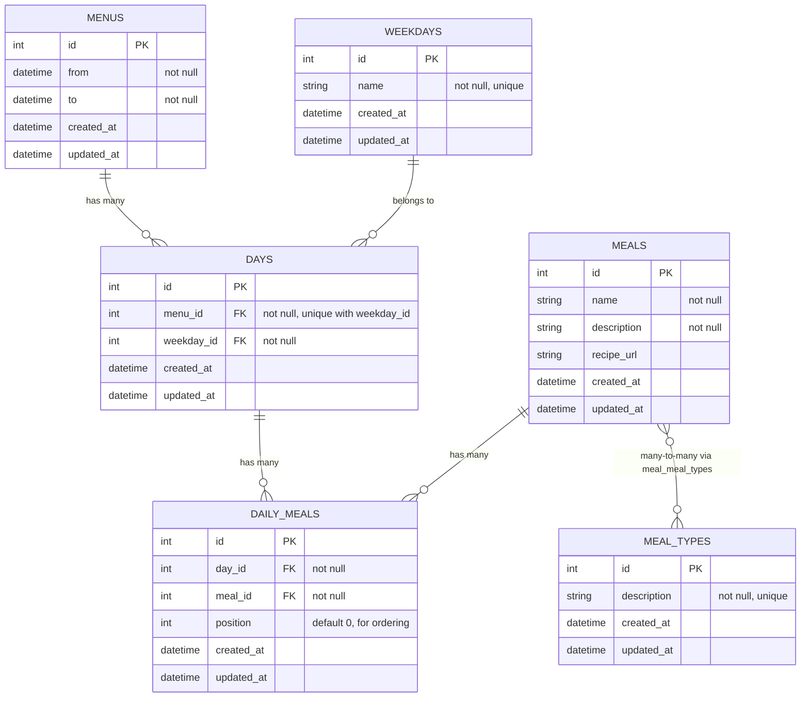

# Database model

The current prototype models menus, days, meals, and meal classifications. It does not yet include users or ownership. The planned multi-user model should add ownership to user-managed records before authentication is introduced.

## Relationships

## Summary

- `Menu` has many `Day` records, one for each weekday.
- `Day` belongs to a `Menu` and a `Weekday`.
- `Day` has many `Meal` records through `DailyMeal`.
- `DailyMeal.position` orders meals within a day: `0` breakfast, `1` lunch, `2` dinner.
- `Meal` has many `MealType` records through `MealMealType`.
- A meal can belong to more than one type, such as breakfast and dinner.
- Seeded meal types are `breakfast`, `lunch`, and `dinner`.

## Constraints

The schema enforces required foreign keys and prevents duplicate relationships:

- One weekday can appear only once within a menu.
- A meal cannot be added twice to the same day.
- Weekday names and meal type descriptions are unique.
