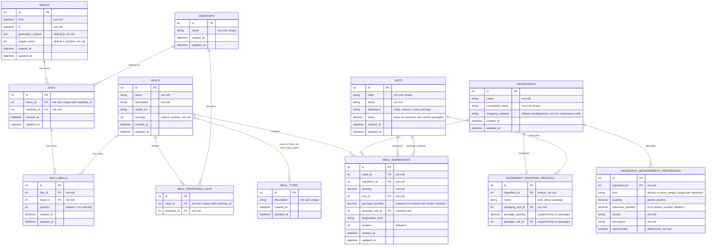

# Database model

The application models shared menus, recipes, ingredients, measurement references,
and buying presentations. It has no authentication or ownership.

## Relationships

## Summary

- `Menu` has many `Day` records, one for each weekday.
- `Menu.people_count` is a positive integer defaulting to 1. `Meal.servings`
  explicitly records the positive number of people served by its stored quantities;
  new recipes have no implicit serving count. Changing counts does not rewrite quantities.
- Shopping lists use `quantity × people_count ÷ servings` for every scheduled
  occurrence, accumulate before rounding, and do not subtract pantry stock.
  Calculable pieces round upward and bulk quantities stay in g/ml. Packages and
  ingredients whose totals cannot be fully converted appear once by name only.
  There are no persisted shopping lists or checked-item records.
- `Day` belongs to a `Menu` and a `Weekday`.
- `Day` has many `Meal` records through `DailyMeal`.
- `DailyMeal.position` orders meals within a day: `0` breakfast, `1` lunch, `2` dinner.
- `Meal` has many `MealType` records through `MealMealType`.
- A meal can belong to more than one type, such as breakfast and dinner.
- `MealPreferredDay` joins meals to preferred `Weekday` records. No rows means
  Any day. These preferences guide automatic generation and apply across the
  meal's types. They do not prevent assignments on other days.
- `Menu.generation_notices` stores generation snapshots in the existing JSON
  array. New entries are objects with `meal_name`, `weekday`, and
  `preferred_days`; the API renders these as localized strings. Historical
  string entries remain supported, including translation of the original
  English notice template. Reading another language does not modify storage.
- Seeded meal types are `breakfast`, `lunch`, and `dinner`.
- `Meal` has many `Ingredient` records through `MealIngredient`.
- `MealIngredient` stores the quantity, unit, preparation note, and display order.
- Units are selected from the structured `Unit` catalog instead of free text.
- Repeated ingredient rows are permitted in one recipe; quantities accumulate by
  ingredient ID while row notes and order remain independent.
- `Unit` stores a fixed standard's dimension and factor to g, ml, or pieces.
  Culinary volumes use 5 ml teaspoons, 15 ml tablespoons, and 240 ml cups.
  Package units have no universal factor. Model validation protects the standard.
- `IngredientMeasurementReference` stores a measured ratio, with at most one
  density and one piece weight per ingredient. `quantity` is grams;
  `reference_quantity` is ml for density or whole pieces for piece weight.
  Ratios use exact rational division during calculation, not a rounded density.
  Sources, descriptions, and approximation flags document each reference.
  The buying-profile API can update the piece-weight reference atomically with
  the profile. New weights get internal provenance; unchanged ratios retain
  existing metadata. No duplicate weight column is added to shopping profiles.
- `IngredientShoppingProfile` independently selects bulk, piece, or package
  buying. A package may store a content quantity and mass/volume/count unit;
  both fields may be null. When supplied they must form a valid pair.
  It is not a cooking conversion. Deleting a profile retains the ingredient's
  measurement references; deleting an unused ingredient removes both.
- Recipe containers store their own content snapshot on `MealIngredient`.
  Updating a shopping presentation never changes recipe contents. Package rows
  allow unknown contents; ordinary recipe measures reject content fields.
- Missing dimension bridges produce one name-only checklist item. Original
  quantities remain stored in recipe rows; no conversion is invented and no
  reference configuration is required. Existing reference records are retained,
  but the client has no measurement-reference form. Preparation notes do not
  automatically apply cooking or peeling yields.
- The measurement rebuild removes legacy equivalences, base units, and `round_up`.
  It clears disposable recipe ingredient rows and installs the standard catalog.
  Seeds recreate sample recipe rows and documented example references.

## Constraints

The schema enforces required foreign keys and prevents duplicate relationships:

- One weekday can appear only once within a menu.
- A meal cannot be added twice to the same day.
- Each preferred weekday can occur only once per meal, with foreign keys to both records.
- An ingredient name is unique after trimming and lowercasing.
- Ingredients may repeat within a meal; the meal/ingredient index is nonunique.
- Meal ingredient units must reference the unit catalog.
- Weekday names and meal type descriptions are unique.
- Recipe servings and menu people counts must be non-null positive integers,
  enforced by model validations and SQLite check constraints.
- Each ingredient has at most one shopping profile and one reference per kind.
- Measurement quantities and recipe quantities are positive, at most 1000000000,
  stored to six decimal places, and must remain positive after storage rounding.
- Profile modes, reference kinds, unit dimensions, positive factors, and package
  content field consistency have database constraints. Cross-table compatibility
  of unit dimensions is validated by models.

## Shopping categories

`ingredients.shopping_category` is a non-null string with default `uncategorized`.
Both a database check constraint and model validation restrict it to the ordered
codes in `ShoppingCategory`: `produce`, `meat`, `deli`, `dairy_eggs`,
`bakery_tortillas`, `pantry`, `frozen`, `uncategorized`. Categories describe grocery
departments and belong to shared ingredients, independently of recipes and optional
shopping profiles. No category table or translated labels are stored.

The category migration assigns the reviewed existing catalog by normalized name,
including canned tuna/corn and packaged sauces to pantry, broccoli and Pulled pork
BBQ Kowi to frozen, and spinach to produce. Unrecognized names remain uncategorized.
This is a one-time backfill; future ingredients default to uncategorized and are
classified explicitly through ingredient editing. Renaming preserves their category.
English and Spanish display labels live in the client translation catalogs.
