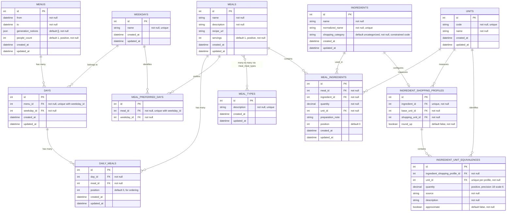

# Database model

The current prototype models menus, days, meals, and meal classifications. It does not yet include users or ownership. The planned multi-user model should add ownership to user-managed records before authentication is introduced.

## Relationships

## Summary

- `Menu` has many `Day` records, one for each weekday.
- `Menu.people_count` stores how many people the menu feeds. `Meal.servings`
  records how many people its stored ingredient quantities serve. Both default
  to `1`, including records predating the fields. Changing either count does
  not rewrite ingredient quantities.
- Shopping lists are calculated from live recipes for each scheduled occurrence
  using `quantity × people_count ÷ servings`, grouped by ingredient and compatible
  requirement units. Mixed units use ingredient-specific base-unit equivalences.
  The list does not round to whole purchase units or deduct pantry stock. There are no shopping-list or checked-item records. Regeneration
  replaces a week's menu ID, preserving its people count unless overridden.
- `Day` belongs to a `Menu` and a `Weekday`.
- `Day` has many `Meal` records through `DailyMeal`.
- `DailyMeal.position` orders meals within a day: `0` breakfast, `1` lunch, `2` dinner.
- `Meal` has many `MealType` records through `MealMealType`.
- A meal can belong to more than one type, such as breakfast and dinner.
- `MealPreferredDay` joins meals to preferred `Weekday` records. No rows means
  Any day. These preferences guide automatic generation and apply across the
  meal's types. They do not prevent assignments on other days.
- `Menu.generation_notices` stores generation snapshots in the existing JSON
  array. New entries are objects with `meal_name`, `weekday`, and
  `preferred_days`; the API renders these as localized strings. Historical
  string entries remain supported, including translation of the original
  English notice template. Reading another language does not modify storage.
- Seeded meal types are `breakfast`, `lunch`, and `dinner`.
- `Meal` has many `Ingredient` records through `MealIngredient`.
- `MealIngredient` stores the quantity, unit, preparation note, and display order.
- Units are selected from the structured `Unit` catalog instead of free text.
- An optional `IngredientShoppingProfile` selects the base and shopping units
  and retains a whole-purchase rounding preference for compatibility. These purchase
  settings do not change shopping-list requirement quantities. Each
  `IngredientUnitEquivalence` expresses one unit in base units and records its
  source, description, and approximation flag. The base can be grams,
  milliliters, or pieces. Profiles and equivalences belong to the shared
  ingredient, not to a recipe or menu. Removing an unused ingredient removes
  its profile and equivalences; changing profiles never rewrites recipes.
- Exact `kg → g` and `l → ml` conversions are application rules; household
  measures, density, piece weights, and package sizes require an explicit
  ingredient-specific equivalence. Missing conversions preserve quantities
  and return warnings. Equivalences and their measurement sources are stored
  directly in the database; no template catalog or name matching is involved.

## Constraints

The schema enforces required foreign keys and prevents duplicate relationships:

- One weekday can appear only once within a menu.
- A meal cannot be added twice to the same day.
- Each preferred weekday can occur only once per meal, with foreign keys to both records.
- An ingredient name is unique after trimming and lowercasing.
- An ingredient cannot be added twice to the same meal.
- Meal ingredient units must reference the unit catalog.
- Weekday names and meal type descriptions are unique.
- Recipe servings and menu people counts must be non-null positive integers,
  enforced by model validations and SQLite check constraints.
- Each ingredient has at most one shopping profile. Each profile can have only
  one equivalence for a given unit. Equivalence factors must be positive at
  database level; models also reject nonfinite factors and conflicting units.

## Shopping categories

`ingredients.shopping_category` is a non-null string with default `uncategorized`.
Both a database check constraint and model validation restrict it to the ordered
codes in `ShoppingCategory`: `produce`, `meat`, `deli`, `dairy_eggs`,
`bakery_tortillas`, `pantry`, `frozen`, `uncategorized`. Categories describe grocery
departments and belong to shared ingredients, independently of recipes and optional
shopping profiles. No category table or translated labels are stored.

The category migration assigns the reviewed existing catalog by normalized name,
including canned tuna/corn and packaged sauces to pantry, broccoli and Pulled pork
BBQ Kowi to frozen, and spinach to produce. Unrecognized names remain uncategorized.
This is a one-time backfill; future ingredients default to uncategorized and are
classified explicitly through ingredient editing. Renaming preserves their category.
English and Spanish display labels live in the client translation catalogs.
